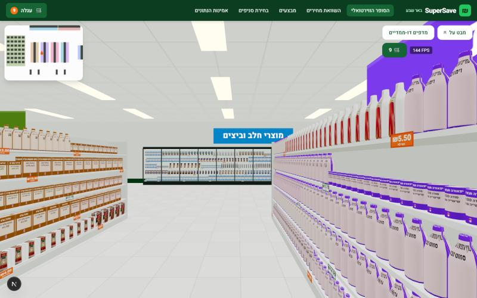
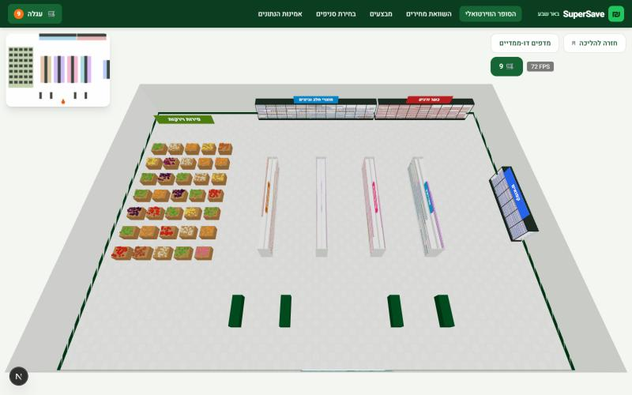
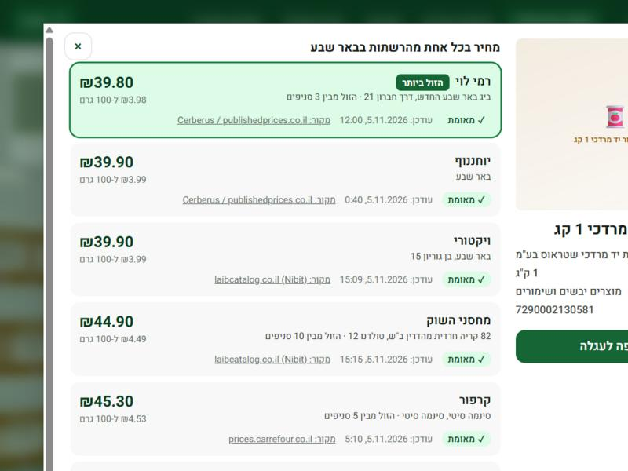
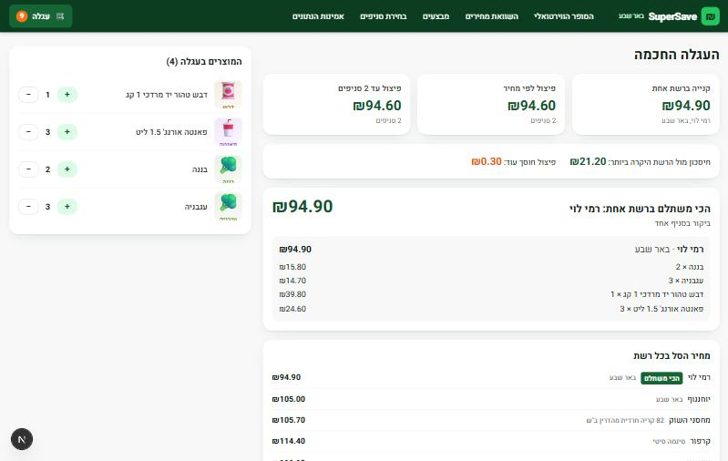
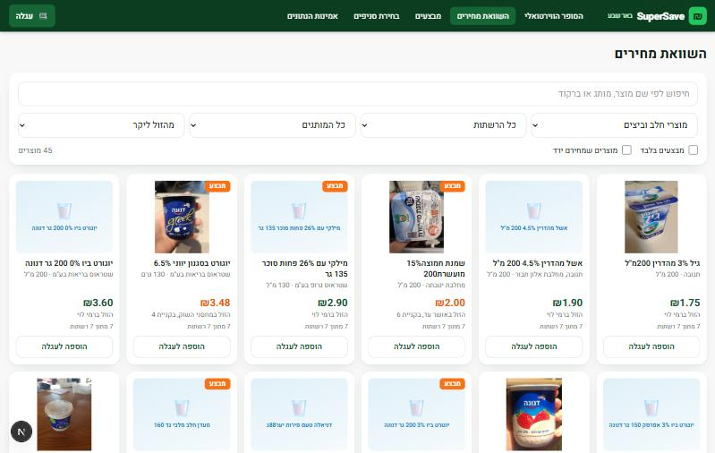
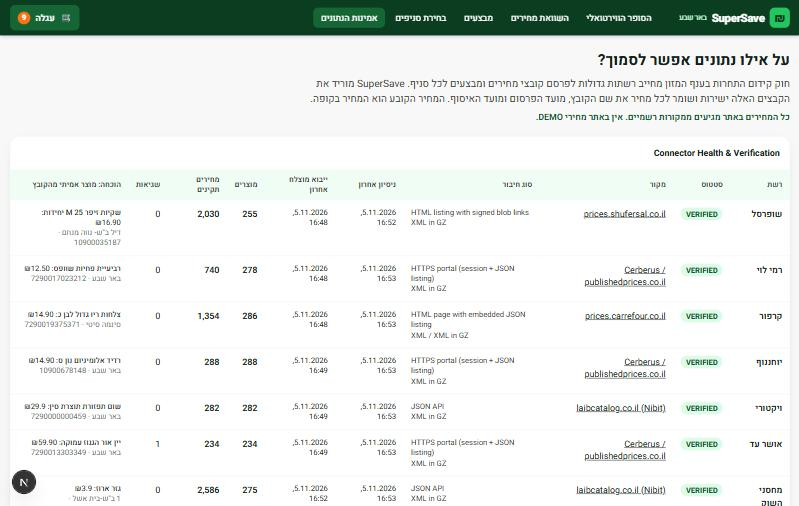

<div dir="rtl">

# SuperSave: סופר וירטואלי והשוואת מחירים בבאר שבע

מסתובבים בסופרמרקט תלת-ממדי כמו במשחק, מכוונים למוצר ורואים את המחיר האמיתי שלו בכל אחת משבע הרשתות בעיר. המחירים מגיעים ישירות מהקבצים הרשמיים שהרשתות מחויבות לפרסם לפי חוק שקיפות המחירים, וליד כל מחיר מוצגים המקור ומועד הפרסום.



| | |
|---|---|
|  |  |
|  |  |
|  |  |

## מצב האימות של שבע הרשתות

תוצאות הבדיקה האחרונה נוצרות אוטומטית ב-[verification/connector-test-report.md](verification/connector-test-report.md). הן מתעדכנות בכל הרצה של `npm run verify:connectors` מרשת שיש לה גישה למקורות.

| רשת | סטטוס | מקור | סניפים בבאר שבע |
|---|---|---|---:|
| שופרסל | VERIFIED | prices.shufersal.co.il | 9 |
| רמי לוי | VERIFIED | url.publishedprices.co.il | 3 |
| קרפור | VERIFIED | prices.carrefour.co.il | 5 |
| יוחננוף | VERIFIED | url.publishedprices.co.il | 1 |
| ויקטורי | VERIFIED | laibcatalog.co.il | 1 |
| אושר עד | VERIFIED | url.publishedprices.co.il | 1 |
| מחסני השוק | VERIFIED | laibcatalog.co.il | 10 |

נכון לבדיקה ב-5.11.2026. אין במערכת מחירי DEMO. המחירים נשמרים במסד הנתונים המקומי ואינם חלק מה-Repository, ולכן אחרי התקנה צריך להריץ ייבוא.

## יכולות

- **סופר תלת-ממדי:** תנועה ב-WASD, מבט בעכבר, ג'ויסטיק ומגע בטלפון, התקרבות למדף, זום, מבט על, מפה קטנה עם קפיצה למחלקה, ומקררים, מקפיאים וארגזי ירקות.
- **אינטראקציה עם מוצר:** הדגשה, שם, המחיר הזול ביותר, והנחיה ללחיצה. לחיצה פותחת חלון השוואה מלא.
- **300 מוצרים ב-10 מחלקות:** 259 מוצרים עם ברקוד אמיתי שנלקח מקובצי הרשתות, ועוד 41 מוצרי משקל ללא ברקוד אחיד.
- **השוואת מחירים:** חיפוש לפי שם, מותג וברקוד, מיון, וסינון לפי רשת, מחלקה, מותג, מבצעים וירידות מחיר.
- **עגלה חכמה:** מחיר הסל בכל רשת, קנייה ברשת אחת, פיצול לפי מחיר, ופיצול עם הגבלת מספר הסניפים (חיפוש מדויק). המערכת מתחשבת בכמות שנדרשת למבצע ומזהירה על מוצרים חסרים.
- **מבצעים:** רק מקובצי המבצעים הרשמיים. קופונים, מועדונים ומבצעים שאי אפשר לפרש בוודאות לא משנים את המחיר המחושב.
- **בחירת סניפים:** 30 סניפים מקובצי הסניפים הרשמיים. ההשוואה והעגלה מתחשבות רק בסניפים שבחרתם.
- **לוח ניהול (`/admin`):** מצב כל מקור, ייבוא ידני, שגיאות, מחירים חסרים, ותור בדיקה למוצרים שלא זוהו בוודאות.
- **שקיפות (`/status`):** דשבורד Connector Health & Verification ומוצר אמיתי מכל קובץ כהוכחה.
- **שלושה מצבי קנייה:** סיור תלת-ממדי, מדפים דו-ממדיים מהירים, והשוואת מחירים רגילה.

## טכנולוגיות

Next.js 15, React 19, TypeScript, Tailwind CSS 4, React Three Fiber, Three.js, Framer Motion, PostgreSQL, Prisma, Python 3 (requests, defusedxml, rapidfuzz, psycopg), Vitest, pytest, GitHub Actions.

תיעוד נוסף: [ארכיטקטורה](docs/architecture.md), [מחקר מקורות הנתונים](docs/data-sources.md).

## התקנה והפעלה מקומית

נדרשים Node.js 20 ומעלה ו-Python 3.11 ומעלה. אין צורך ב-Docker או בהתקנת PostgreSQL: הפקודה `db:start` מפעילה PostgreSQL מקומי.

</div>

```bash
git clone https://github.com/neho2708-glitch/supersave-beersheva.git
```

```bash
cd supersave-beersheva
```

```bash
npm install
```

```bash
pip install -r data-engine/requirements.txt
```

```bash
cp .env.example .env
```

```bash
cp .env frontend/.env
```

```bash
npm run db:start
```

```bash
npm run db:generate
```

```bash
npm run db:migrate
```

```bash
npm run db:seed
```

```bash
npm run import:all
```

```bash
npm run dev
```

<div dir="rtl">

האתר עולה בכתובת http://localhost:3000. הייבוא הראשון לוקח כמה דקות. עצירת מסד הנתונים: `npm run db:stop`.

## משתני סביבה

| משתנה | תפקיד |
|---|---|
| `DATABASE_URL` | חיבור ל-PostgreSQL. ברירת המחדל ב-`.env.example` מתאימה ל-`db:start` |
| `ADMIN_TOKEN` | סיסמת `/admin` (עם שם משתמש כלשהו). בלעדיו האזור פתוח בפיתוח וסגור בפרודקשן |
| `PRICE_STALE_AFTER_HOURS` | אחרי כמה שעות מחיר מסומן STALE. ברירת מחדל: 48 |
| `PYTHON_BIN` | פקודת Python לכפתור הייבוא הידני |

## הרצת Data Connectors

</div>

```bash
npm run import:all
```

```bash
node scripts/engine.mjs import --chain rami-levy
```

```bash
node scripts/engine.mjs schedule --every-hours 6
```

<div dir="rtl">

הפקודה האחרונה היא תזמון רציף. אפשרות נוספת היא הקובץ `.github/workflows/ingest.yml`, שרץ כל 6 שעות אם הוגדר הסוד `DATABASE_URL`. קבצים גולמיים נשמרים ב-`data-engine/raw/` לביקורת.

## בדיקות

</div>

```bash
npm run test:all
```

<div dir="rtl">

הפקודה מריצה בדיקות TypeScript, בדיקות Python ובדיקה חיה של שבעת המקורות, וכותבת את התוצאות ל-`verification/`. אפשר להריץ כל חלק בנפרד: `npm test`, `npm run test:engine`, `npm run verify:connectors`.

## פריסה לאינטרנט

1. **מסד נתונים:** PostgreSQL מנוהל (למשל Supabase או Neon), והרצת `npm run db:migrate` ו-`npm run db:seed` מולו.
2. **אתר:** Vercel עם `frontend` כתיקיית השורש, והגדרת `DATABASE_URL`, `ADMIN_TOKEN` ו-`PRICE_STALE_AFTER_HOURS`. צריך לאפשר גישה לקבצים שמחוץ לתיקיית השורש, כי האתר מייבא מ-`backend/`.
3. **ייבוא מתוזמן:** על שרת או Self-hosted Runner בישראל, כי חלק מהמקורות חוסמים כתובות מחו"ל. הגדירו את הסוד `DATABASE_URL` ואת המשתנה `INGEST_RUNNER` ב-GitHub.

כפתור הייבוא הידני ב-`/admin` עובד רק על שרת שמותקן בו Python, ולכן הוא לא יפעל ב-Vercel. שם הייבוא רץ רק דרך התזמון.

## מגבלות ידועות

- **תנאי שימוש:** דף התקנות ב-gov.il חסום לגישה אוטומטית, ולכן תנאי השימוש לא נבדקו. יש לקרוא אותם לפני השקה מסחרית.
- **תמונות:** רק ל-43 מוצרים יש תמונה ברישיון פתוח. לשאר מוצגת תמונת מילוי.
- **היסטוריית מחירים:** האיסוף התחיל ב-5.11.2026. גרף יופיע כשיהיו נתונים משני ימים לפחות, וירידות מחיר מופיעות רק אחרי שנרשם שינוי.
- **מבצעים:** רק מבצעים פשוטים נכללים בחישוב (סוגי הטבה 1 ו-10). השאר מוצגים כטקסט. מבצעי חבילה על כמה מוצרים שונים מחושבים לכל מוצר בנפרד.
- **מוצרי משקל:** ההתאמה נעשית לפי כללי שם. פריט ששמו שונה לא יקבל מחיר עד שיאושר ב-`/admin`, ולכן חלק מהרשתות עשויות להיראות חסרות.
- **ארבעה מוצרים** מתוך 300 לא קיבלו מחיר בשום רשת בבאר שבע, ומוצגים כ"לא נמצא מחיר זמין".
- **סניפים:** הרשימה נלקחת מקובצי הרשתות, ולא נבדק בשטח שכל סניף פתוח. הוחרגו פורמטים שאינם סופרמרקט (Be, סיטונאות).
- **נתון מקור שגוי:** בקובץ של קרפור נמצא StoreID שונה ממספר הסניף שבשם הקובץ. המערכת מסתמכת על שם הקובץ. מחיר חריג מסומן ואינו נחשב לזול ביותר.
- **טלפונים:** מצב המובייל נבדק באמולציה בלבד ולא על מכשיר אמיתי. הטעינה הראשונה של הסצנה בו איטית יחסית.
- **תלת-ממד:** אין מודל נפרד לכל מוצר, והמוצרים משתמשים באריזות גנריות עם תמונה או עיצוב מילוי.
- **התרחבות:** כדי לכסות את כל הארץ צריך להחליף את הטעינה לזיכרון בשאילתות SQL ולהפוך את בחירת העיר להגדרה.

## רישיון

הקוד ברישיון [MIT](LICENSE). התמונות מ-Open Food Facts ברישיון CC BY-SA. המחירים והמבצעים שייכים למפרסמים שלהם. המחיר הקובע הוא המחיר בקופה.

</div>
